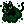
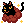
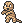

# 粒子名称、图标与孵蛋规则

核对日期：2026-11-14。离线目录收录 42 种图标：40 种普通粒子，以及闪光、秘密闪光两种特殊身份标记。闪光标记不作为可自由叠加的普通粒子目标。

这是截至核对日期从公开指南、2026 活动资料交叉核对的名单，不表示未来不会新增。中文名称可能随语言包不同；程序同时保留英文名称与常见中文别名，库存保存稳定的英文 ID。下表每个图标均链接本项目实际使用的 24×24 原图。

用户示例中的金色木乃伊图标对应 **闪光灵棺 / Shiny Sarcophagus**，不是普通灵棺。

## 普通粒子（40 种）

| 图标 | 中文 | 英文 | 客户端编号 |
| --- | --- | --- | --- |
|  | 鬼火 | Hitodama | 2 |
|  | 蝙蝠 | Bats | 3 |
|  | 幽灵 | Ghosts | 4 |
|  | 眼瞳 | The Eye | 5 |
|  | 欢乐南瓜王 | Pumpking's Delight | 6 |
|  | 耀星 | Rising Star | 7 |
|  | 雪花 | Snowflake | 8 |
|  | 礼物 | Present | 9 |
|  | 纸灯笼 | Paper Lantern | 10 |
|  | 烟花 | Fireworks | 11 |
|  | 恶臭 | Pungent Stench | 12 |
|  | 黑洞 | Black Hole | 13 |
|  | 女巫的瘴气 | Witch's Haze | 14 |
|  | 南瓜小孩的款待 | Pumpkid's Treat | 15 |
|  | 巫婆猫 | Witch's Cat | 16 |
|  | 南瓜猫 | Pumpcat | 17 |
|  | 小白猫 | White Kitty | 18 |
|  | 镰刀飞旋 | Spinning Scythe | 19 |
|  | 蛛网 | Spider's Web | 20 |
|  | 丧尸之握 | Zombie's Grip | 21 |
|  | 生肖 | Zodiac | 22 |
|  | 狼嚎 | Eerie Howl | 23 |
|  | 墓地 | Graveyard | 24 |
|  | 帝殒 | King's Fall | 25 |
|  | 赤龙 | Red Dragon | 26 |
|  | 周年蛋糕 | Anniversary Cake | 27 |
|  | 关都伙伴 | Kanto Friends | 28 |
|  | 闪光关都伙伴 | Shiny Kanto Friends | 29 |
|  | 鬼盆栽 | Menacing Spirit | 30 |
|  | 闪光鬼盆栽 | Shiny Menacing Spirit | 31 |
|  | 圣诞装饰 | Xmas Decorations | 32 |
|  | 春精灵 | Spirit of Spring | 33 |
|  | 幽灵猫 | Phantom | 35 |
|  | 闪光幽灵猫 | Shiny Phantom | 36 |
|  | 暗晶 | Dark Crystal | 37 |
|  | 闪光暗晶 | Shiny Dark Crystal | 38 |
|  | 白莲花 | Lotus Field | 39 |
|  | 血莲花 | Blood Lotus Field | 40 |
|  | 灵棺 | Sarcophagus | 41 |
|  | 闪光灵棺 | Shiny Sarcophagus | 42 |

## 特殊身份标记（2 种）

| 图标 | 中文 | 英文 |
| --- | --- | --- |
|  | 闪光 | Shiny |
|  | 秘密闪光 | Secret Shiny |

## 录入与规划

- 两端只识别面板当前显示的粒子图标。可靠时填写名称并勾选“带粒子”；无法确定名称时保留“带粒子”供人工核对，不猜名字。
- “多粒子 / 选择粒子”由用户主动打开，补齐其他实际粒子后保存。不会弹窗要求连续录入用户补选。
- 默认保护粒子素材和时装素材。粒子提供“指定粒子”“无视粒子”“同种限一次”三种启用方式；无视粒子允许重复投入，同种限一次允许普通使用但禁止重复粒子。
- 指定粒子可多选。指定和限一次模式都检查双亲的全部实际粒子；母体已带 A、B，下一只素材不能再带 A 或 B。后代继续保有 A、B 不属于新投入。粒子同时沿支线合并，不依导图节点累计次数。
- 未命名粒子在严格模式继续保护；无视模式可使用，并在后代保留“带粒子”的登记。
- 目标需要粒子时先考虑可帮助升 V、锁性格的素材；无有效 V 的粒子可用真实配种先接到低 V 素材，再升 V。仍须遵守护腕、不变石、性别、蛋组、头目、梦特与技能限制。
- 时装手动登记，当前支持小火龙、狃拉／玛狃拉、圆陆鲨／烈咬陆鲨、利欧路／路卡利欧、喵喵／猫老大五个进化家族。勾选时装目标后保留同一时装后代主线，公体可用百变怪转母；仅本次规划关闭 X 位 31 素材保护。时装公体允许把转母与保证升 V 合为一步（例如 0V 时装公体＋护腕 1V 百变怪），仍须保留母系原目标 IV、且子代不低于双方素材档位；普通公体保留原转换保护。
- 随机性别、提前性格、阶段收尾与重启续算都保存最终粒子目标和原时装母系。父母登记被修改后，旧路线不能继续核销，必须按新资料重算。

## 资料来源与图像权属

- [PokeMMO 粒子指南](https://forums.pokemmo.com/index.php?/topic/149548-particles-guide-previews-and-release-information-20/)：38 种旧图标、英文名称与预览。
- [2026 万圣节活动指南](https://forums.pokemmo.com/index.php?/topic/201256-halloween-2026-the-ultimate-halloween-event-guide/)：灵棺、闪光灵棺与五个时装家族。
- [PokeMMO 2026 万圣节更新记录](https://forums.pokemmo.com/index.php?/topic/201445-changelog-halloween-2026/)：活动与时装配种修正。
- [Pikammo 外观目录](https://www.pikammo.fr/Pokemmo/en/tools/cosmetiques)：Lotus Field、Blood Lotus Field 图标。

具体图片来源 URL 与 SHA-256 见 [机器可读目录](../data/particles.json)。图标仅作离线识别与选择对照，原权利属于相应游戏、作品与作者；不宣称自创或重新授权。未打包游戏客户端、ROM、用户截图、库存或语言包。
